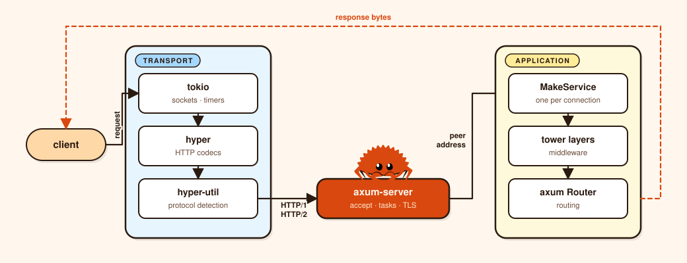

[](https://choosealicense.com/licenses/mit/)
[](https://crates.io/crates/axum-server)
[](https://docs.rs/axum-server/)

# axum-server

axum-server is the server layer for [axum] and other [tower] services. Point it
at a port or Unix socket, hand it a [`Router`][router], and it owns what happens around
the request: TLS through [rustls] or [openssl], HTTP/1 and HTTP/2 on one port,
timeouts, certificate reloads, and shutdown.

It is the layer [hyper] 1.0 stopped shipping. Before that release,
[`hyper::Server`][hyper-server] owned the accept loop and axum-server wrapped it. Since 0.6,
the crate owns the loop itself.

axum is the usual way to build the service, not a requirement. Prefer this over
[`axum::serve`][axum-serve] when you need TLS, configurable timeouts, connection-level
acceptors, a bounded drain, or live connection counts.

This project is maintained by the community independently from [axum].



## Basics

### Serving model

```rust
use axum::{routing::get, Router};
use std::net::SocketAddr;

#[tokio::main]
async fn main() {
    let app = Router::new().route("/", get(|| async { "Hello, world!" }));

    axum_server::bind(SocketAddr::from(([127, 0, 0, 1], 3000)))
        .serve(app.into_make_service())
        .await
        .unwrap();
}
```

Binding is lazy. The address is recorded up front, and the socket opens when the
server is polled.

The [`MakeService`][make-service] is called once per connection with the peer
address, and one task drives HTTP for that connection. HTTP/2 streams multiplex
over that task, so blocking it stalls every stream. Blocking work belongs in
[`spawn_blocking`][spawn-blocking].

### Without axum

[`serve`][serve] takes a tower [`MakeService`][make-service]: a service of services, with the connection
address as its target. A plain [`service_fn`][service-fn] is enough.

```rust
use bytes::Bytes;
use http_body_util::Full;
use hyper::{body::Incoming, Request, Response};
use std::{convert::Infallible, net::SocketAddr};
use tower::service_fn;
use tower_http::add_extension::AddExtension;

let service = service_fn(|mut req: Request<Incoming>| async move {
    let addr: SocketAddr = req.extensions_mut().remove().unwrap();
    Ok::<_, Infallible>(Response::new(Full::new(Bytes::from(format!("{addr}")))))
});

axum_server::bind(addr)
    .serve(service_fn(|addr: SocketAddr| async move {
        Ok::<_, Infallible>(AddExtension::new(service, addr))
    }))
    .await?;
```

The outer maker receives the peer address, and [`AddExtension`][add-extension] carries it into
the request. No axum type appears, and the same TLS, listeners, and shutdown
apply.

Runnable versions are in
[examples](https://github.com/programatik29/axum-server/tree/master/examples).

## Connections

### The accept hook

Every connection passes through the [`Accept`][accept] trait once, after the
socket is accepted and before hyper reads a byte. It receives the raw stream and
the per-connection service.

The hook returns a stream, possibly wrapped in TLS, and a service, possibly
carrying per-connection state. Returning an error rejects the connection.

```rust
pub trait Accept<I, S> {
    type Stream;
    type Service;
    type Future: Future<Output = io::Result<(Self::Stream, Self::Service)>>;

    fn accept(&self, stream: I, service: S) -> Self::Future;
}
```

Either associated type can change. [`RustlsAcceptor`][rustls-acceptor] consumes a TCP stream,
performs the handshake, and returns a TLS stream plus a service carrying
[`TlsInfo`][tls-info].

Inner acceptors run first, so socket options apply before the handshake.

```rust
use axum_server::accept::{TcpConfigAcceptor, TcpKeepaliveConfig, TcpSocketConfig};
use axum_server::tls_rustls::{RustlsAcceptor, RustlsConfig};
use axum_server::Server;
use std::time::Duration;

let config = RustlsConfig::from_pem_file("cert.pem", "key.pem").await?;

let acceptor = RustlsAcceptor::new(config)
    .handshake_timeout(Duration::from_secs(5))
    .acceptor(TcpConfigAcceptor::new(
        TcpSocketConfig::new()
            .nodelay(true)
            .keepalive(TcpKeepaliveConfig::new().time(Duration::from_secs(60))),
    ));

Server::bind(addr)
    .acceptor(acceptor)
    .serve(app.into_make_service())
    .await?;
```

TLS cannot be a tower layer. A layer sees a request, an acceptor sees the
socket, before any HTTP byte. Returning an error drops the connection and
reports it to [`accept_error_handler`][accept-error-handler].

Custom acceptors implement the trait directly. Here is an example:

```rust
use axum_server::accept::Accept;
use std::{collections::HashSet, future::Ready, io, net::IpAddr, sync::Arc};
use tokio::net::TcpStream;

/// Rejects peers by IP before hyper reads anything.
/// Returning an error from `accept` drops the connection.
#[derive(Clone)]
struct DenyList(Arc<HashSet<IpAddr>>);

impl<S: Send + 'static> Accept<TcpStream, S> for DenyList {
    type Stream = TcpStream;
    type Service = S;
    type Future = Ready<io::Result<(TcpStream, S)>>;

    fn accept(&self, stream: TcpStream, service: S) -> Self::Future {
        let allowed = match stream.peer_addr() {
            Ok(peer) => !self.0.contains(&peer.ip()),
            Err(_) => false,
        };

        std::future::ready(if allowed {
            Ok((stream, service))
        } else {
            Err(io::Error::new(io::ErrorKind::PermissionDenied, "denied peer"))
        })
    }
}
```

### Protocol negotiation

A cleartext listener has to guess. [hyper-util] assumes HTTP/2 and falls back
to HTTP/1.1 unless the first bytes are the HTTP/2 preface
([`PRI * HTTP/2.0`][h2-preface]). Over TLS, ALPN settles on [`h2`][h2-alpn] or
[`http/1.1`][http-1-1] before any HTTP byte. Cleartext HTTP/2 needs prior
knowledge, since the older [`Upgrade: h2c`][h2-upgrade] handshake is not
supported.

By default, the server auto-detects HTTP/1 or HTTP/2 and keeps HTTP/1 upgrades
enabled, which WebSocket handshakes need. Calling [`http1_only`][http1-only] or
[`http2_only`][http2-only] pins a version and disables WebSockets. HTTP/1 and
HTTP/2 limits are set on [`http_builder()`][http-builder].

### TLS

[`RustlsConfig`][rustls-config] wraps an [`ArcSwap`][arc-swap] around the current server config. Reload
swaps the config used by new handshakes.

Established connections keep the config they negotiated. No lock on the
handshake path, no dropped connections.

```rust
use axum_server::tls_rustls::RustlsConfig;
use tokio::signal::unix::{signal, SignalKind};

let config = RustlsConfig::from_pem_file("cert.pem", "key.pem").await?;

let mut hup = signal(SignalKind::hangup())?;
tokio::spawn({
    let config = config.clone();
    async move {
        while hup.recv().await.is_some() {
            config.reload_from_pem_file("cert.pem", "key.pem").await.unwrap();
        }
    }
});

axum_server::bind_rustls(addr, config)
    .serve(app.into_make_service())
    .await?;
```

PEM and DER constructors set ALPN ([`h2`][h2-alpn] and [`http/1.1`][http-1-1]). Building a
[`ServerConfig`][server-config] yourself means setting it too, or [`h2`][h2-alpn]
silently turns off. [`from_sni_pem_files`][sni-pem-files] matches certificates
by exact name. For names resolved during the handshake, see the
[`async_sni`][async-sni-example] example.

After the handshake, handlers get SNI, ALPN, and client certificates through
[`TlsInfo`][tls-info]. Client certificates need a verifier such as
[`WebPkiClientVerifier`][webpki-client-verifier].

The rustls provider is process-global. [`tls-rustls`][tls-rustls-docs] brings
[`aws-lc-rs`][aws-lc-rs], while [`tls-rustls-no-provider`][features] leaves the
choice to your application. [`tls-openssl`][tls-openssl-docs] is for FIPS
environments. Handshakes time out after ten seconds by default.

## Operations

### Shutdown

Shutdown stops the listener, then decides what happens to requests in flight.
[`shutdown()`][shutdown] resets them immediately.
[`graceful_shutdown`][graceful-shutdown] lets them finish, waits for the
deadline, then cancels the rest. With no deadline it waits indefinitely.

HTTP/1 closes after the current response. HTTP/2 sends [`GOAWAY`][h2-goaway].

```rust
use axum_server::Handle;
use std::time::Duration;

let handle = Handle::new();

let shutdown = handle.clone();
tokio::spawn(async move {
    tokio::signal::ctrl_c().await.unwrap();
    shutdown.graceful_shutdown(Some(Duration::from_secs(30)));
});

// Resolves when the drain finishes or the deadline expires.
axum_server::bind(addr)
    .handle(handle)
    .serve(app.into_make_service())
    .await?;
```

On [`SIGTERM`][signal-7], drain with a deadline shorter than the grace period, wait for the
server to return, then exit. [`connection_count()`][connection-count] reports the live count, and
[`listening()`][listening] returns the bound address.

#### One connection

A handler can close the connection that dispatched the request by extracting
[`ConnectionShutdown`][connection-shutdown], which axum-server adds to every request.
[`shutdown()`][connection-shutdown-shutdown] cancels the connection immediately.

[`graceful_shutdown()`][connection-shutdown-graceful] delivers the current response and then
closes. The handle can also be moved into another task, for example to enforce a deadline on a
slow client.

```rust
use axum::{extract::Extension, routing::get, Router};
use axum_server::ConnectionShutdown;

async fn handle(Extension(shutdown): Extension<ConnectionShutdown>) -> &'static str {
    shutdown.graceful_shutdown();
    "goodbye"
}

let app: Router = Router::new().route("/", get(handle));
```

On HTTP/2 the connection carries many streams, so closing it closes all of them.

### Bounds

Timeouts are layered. Protocol detection, header reading, and idle HTTP/2
connections each have their own bound, so one does not overlap another.

```rust
use axum_server::Server;
use std::time::Duration;

// Close a new connection that sends no request in time.
let mut server = Server::bind(addr).first_request_timeout(Duration::from_secs(10));

// Bound reading request headers.
let mut http1 = server.http_builder().http1();
http1.header_read_timeout(Duration::from_secs(10));

// Probe idle HTTP/2 connections and close ones that stop answering.
let mut http2 = server.http_builder().http2();
http2.keep_alive_interval(Duration::from_secs(30));
http2.keep_alive_timeout(Duration::from_secs(10));
```

Without a first-request timeout, a silent client holds a task and a descriptor.
hyper's 30s header default is disabled here to preserve older behavior. The TLS
handshake has its own [`handshake_timeout`][handshake-timeout], and idle TCP can
use [`TcpKeepaliveConfig`][tcp-keepalive-config] on the acceptor.

There is no connection cap. The listen queue and the make service's readiness
are the only backpressure. An acceptor runs after accept, so it can reject but
not throttle.

### Listeners

An IP address binds TCP. A Unix socket address binds Unix, with identical TLS,
acceptors, and shutdown.

A Unix socket has no port, is unreachable from the network, and is governed by
filesystem permissions. Its path must not already exist on restart, unless
systemd owns it, in which case pass the inherited listener through
[`from_unix`][from-unix].

```rust
use std::os::unix::net::SocketAddr;

let addr = SocketAddr::from_pathname("/run/myapp.sock")?;

axum_server::bind(addr)
    .serve(app.into_make_service())
    .await?;
```

[`from_tcp`][from-tcp] and [`from_unix`][from-unix] accept pre-bound listeners for socket activation and
for options set before handoff, such as [`SO_REUSEPORT`][socket-7] or the backlog. Several
addresses mean several servers.

A [`Handle<A>`][handle] belongs to one address type and reports one listening address.
[`Control`][control] is address-agnostic. Build a handle for each server with
[`Handle::with_control`][handle-with-control], and one `graceful_shutdown` drains
every listener. `connection_count` sums them, so TCP and Unix can share one
control.

```rust
use axum_server::{Control, Handle};
use std::{net::SocketAddr, time::Duration};

let control = Control::new();

let tcp_handle = Handle::<SocketAddr>::with_control(control.clone());
let tcp = axum_server::bind(tcp_addr).handle(tcp_handle.clone());

#[cfg(unix)]
let unix_handle = Handle::<std::os::unix::net::SocketAddr>::with_control(control.clone());
#[cfg(unix)]
let unix = axum_server::bind(unix_addr).handle(unix_handle.clone());

// Serve both, then drain them together.
control.graceful_shutdown(Some(Duration::from_secs(30)));
```

See [`examples/multiple_listeners.rs`][multiple-listeners-example] for a full program.

## Reference

### Cargo features

```toml
[dependencies]
axum-server = "0.9"
# axum-server = { version = "0.9", features = ["tls-rustls"] }
```

- [`tls-rustls`][tls-rustls-docs] — [rustls] with [`aws-lc-rs`][aws-lc-rs], TLS 1.2 and 1.3.
- [`tls-rustls-no-provider`][features] — rustls without a provider, so choose [`ring`][ring] or
  install one at startup.
- [`tls-rustls-encrypted-keys`][features] — encrypted PKCS#8 private keys.
- [`tls-openssl`][tls-openssl-docs] — TLS through [openssl].

No TLS backend is on by default.

### MSRV

1.82.

### Safety

[`#![forbid(unsafe_code)]`][forbid].

### License

[MIT](LICENSE).

[router]: https://docs.rs/axum/latest/axum/struct.Router.html
[axum-serve]: https://docs.rs/axum/latest/axum/fn.serve.html
[connect-info]: https://docs.rs/axum/latest/axum/extract/struct.ConnectInfo.html
[into-make-service]: https://docs.rs/axum/latest/axum/struct.Router.html#method.into_make_service
[hyper-server]: https://docs.rs/hyper/0.14/hyper/server/struct.Server.html
[make-service]: https://docs.rs/tower/latest/tower/trait.MakeService.html
[spawn-blocking]: https://docs.rs/tokio/latest/tokio/task/fn.spawn_blocking.html
[local-addr-acceptor]: https://docs.rs/axum-server/latest/axum_server/accept/struct.LocalAddrAcceptor.html
[h2-preface]: https://www.rfc-editor.org/rfc/rfc9113.html#section-3.4
[h2-alpn]: https://www.rfc-editor.org/rfc/rfc9113.html#section-3.1
[http-1-1]: https://www.rfc-editor.org/rfc/rfc9112.html
[h2-upgrade]: https://www.rfc-editor.org/rfc/rfc9113.html#section-3.1
[http1-only]: https://docs.rs/axum-server/latest/axum_server/struct.Server.html#method.http1_only
[http2-only]: https://docs.rs/axum-server/latest/axum_server/struct.Server.html#method.http2_only
[http-builder]: https://docs.rs/axum-server/latest/axum_server/struct.Server.html#method.http_builder
[accept]: https://docs.rs/axum-server/latest/axum_server/accept/trait.Accept.html
[rustls-acceptor]: https://docs.rs/axum-server/latest/axum_server/tls_rustls/struct.RustlsAcceptor.html
[tls-info]: https://docs.rs/axum-server/latest/axum_server/tls/struct.TlsInfo.html
[accept-error-handler]: https://docs.rs/axum-server/latest/axum_server/struct.Server.html#method.accept_error_handler
[rustls-config]: https://docs.rs/axum-server/latest/axum_server/tls_rustls/struct.RustlsConfig.html
[arc-swap]: https://docs.rs/arc-swap/latest/arc_swap/type.ArcSwap.html
[server-config]: https://docs.rs/rustls/latest/rustls/server/struct.ServerConfig.html
[sni-pem-files]: https://docs.rs/axum-server/latest/axum_server/tls_rustls/struct.RustlsConfig.html#method.from_sni_pem_files
[async-sni-example]: https://github.com/programatik29/axum-server/blob/master/examples/async_sni.rs
[webpki-client-verifier]: https://docs.rs/rustls/latest/rustls/server/struct.WebPkiClientVerifier.html
[tls-rustls-docs]: https://docs.rs/axum-server/latest/axum_server/tls_rustls/index.html
[features]: https://docs.rs/crate/axum-server/latest/features
[aws-lc-rs]: https://crates.io/crates/aws-lc-rs
[tls-openssl-docs]: https://docs.rs/axum-server/latest/axum_server/tls_openssl/index.html
[shutdown]: https://docs.rs/axum-server/latest/axum_server/struct.Handle.html#method.shutdown
[graceful-shutdown]: https://docs.rs/axum-server/latest/axum_server/struct.Handle.html#method.graceful_shutdown
[h2-goaway]: https://www.rfc-editor.org/rfc/rfc9113.html#section-6.8
[signal-7]: https://man7.org/linux/man-pages/man7/signal.7.html
[connection-count]: https://docs.rs/axum-server/latest/axum_server/struct.Handle.html#method.connection_count
[listening]: https://docs.rs/axum-server/latest/axum_server/struct.Handle.html#method.listening
[handshake-timeout]: https://docs.rs/axum-server/latest/axum_server/tls_rustls/struct.RustlsAcceptor.html#method.handshake_timeout
[tcp-keepalive-config]: https://docs.rs/axum-server/latest/axum_server/accept/struct.TcpKeepaliveConfig.html
[connection-shutdown]: https://docs.rs/axum-server/latest/axum_server/struct.ConnectionShutdown.html
[connection-shutdown-shutdown]: https://docs.rs/axum-server/latest/axum_server/struct.ConnectionShutdown.html#method.shutdown
[connection-shutdown-graceful]: https://docs.rs/axum-server/latest/axum_server/struct.ConnectionShutdown.html#method.graceful_shutdown
[from-unix]: https://docs.rs/axum-server/latest/axum_server/fn.from_unix.html
[from-tcp]: https://docs.rs/axum-server/latest/axum_server/fn.from_tcp.html
[socket-7]: https://man7.org/linux/man-pages/man7/socket.7.html
[handle]: https://docs.rs/axum-server/latest/axum_server/struct.Handle.html
[control]: https://docs.rs/axum-server/latest/axum_server/struct.Control.html
[handle-with-control]: https://docs.rs/axum-server/latest/axum_server/struct.Handle.html#method.with_control
[multiple-listeners-example]: https://github.com/programatik29/axum-server/blob/master/examples/multiple_listeners.rs
[serve]: https://docs.rs/axum-server/latest/axum_server/struct.Server.html#method.serve
[service-fn]: https://docs.rs/tower/latest/tower/fn.service_fn.html
[add-extension]: https://docs.rs/tower-http/latest/tower_http/add_extension/struct.AddExtension.html
[ring]: https://crates.io/crates/ring
[forbid]: https://doc.rust-lang.org/reference/attributes/diagnostics.html#the-forbid-attribute
[axum]: https://crates.io/crates/axum
[hyper]: https://crates.io/crates/hyper
[hyper-util]: https://crates.io/crates/hyper-util
[openssl]: https://crates.io/crates/openssl
[rustls]: https://crates.io/crates/rustls
[tower]: https://crates.io/crates/tower
